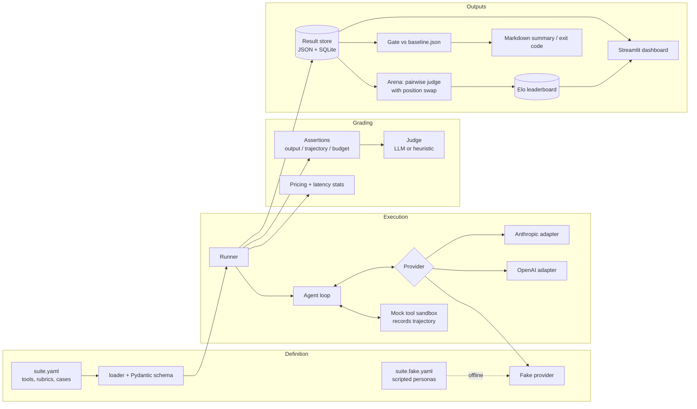

# agent-evals-arena

**Unit tests for tool-using LLM agents.** Describe behaviour in YAML, run it against any model,
grade with assertions and an LLM judge, rank models head-to-head with Elo, and block pull requests
that make your agent worse.

[](https://github.com/alexgeorghiou/agent-evals-arena/actions/workflows/ci.yml)
[](LICENSE)


---

## Why

Agents fail in ways a plain "compare the final string" test cannot see: they call the wrong tool,
pass a sloppy argument, book a calendar slot nobody asked for, or quietly invent a number after a
tool error. `agent-evals-arena` treats the **trajectory** - the ordered list of tool calls - as a
first-class thing to assert on, alongside the final answer, cost and latency.

## Features

- **YAML suites, validated by Pydantic** - mock tools with canned responses (matched on arguments
  using partial / glob / regex patterns), rubrics, cases and assertions, with precise error
  messages for typos.
- **Thirteen assertion types**
  - output: `contains`, `not_contains`, `equals`, `regex`, `json_schema`
  - trajectory: `tool_called` (args + min/max times), `tool_not_called`, `tool_sequence`
    (`subsequence` / `contiguous` / `exact`), `max_tool_calls`, `no_tool_errors`
  - budget: `latency`, `cost`
  - quality: `judge` (LLM-as-judge against a weighted rubric)
- **Provider-neutral agent loop** - a small tool-calling loop over a neutral message format, with
  adapters for the Anthropic Messages API and OpenAI Chat Completions, plus a deterministic
  **scripted fake provider** so everything runs offline in CI.
- **LLM-as-judge** - weighted criteria, configurable scale, robust JSON extraction (fences, prose,
  nested braces), clamping, and a deterministic heuristic judge for offline runs.
- **Pairwise arena with Elo** - run two models on the same suite; each case is judged twice with
  the answers **swapped** to cancel position bias; clear assertion-score gaps break judge ties;
  ratings and match history persist in SQLite.
- **Cost and latency tracking** - per-case token usage, a price table (overridable via YAML),
  p50/p95 latency and a bootstrap confidence interval on the suite score.
- **Regression gating** - a committed baseline file; the gate fails on a mean-score drop, a
  pass-rate drop, any previously-passing case that now fails, or cost/latency growth beyond a
  budget. Markdown output goes straight into `$GITHUB_STEP_SUMMARY`.
- **Streamlit dashboard** - runs over time, per-case drilldown with the full trajectory and
  assertion table, Elo leaderboard, cost-vs-quality scatter.
- **CLI** - `arena validate | run | baseline | gate | compare | leaderboard | runs | show`.

## Architecture



## Quickstart

```bash
python -m venv .venv && source .venv/bin/activate     # Windows: .venv\Scripts\activate
pip install -e ".[dev,dashboard]"

arena validate suites                                  # schema-check every suite
arena run suites                                       # offline, fake:fake-strong
arena run suites -m fake:fake-sloppy                   # watch the assertions catch a bad agent
arena compare suites -a fake:fake-strong -b fake:fake-sloppy
arena leaderboard
arena gate suites --baseline baselines/baseline.json   # exit 1 on regression
streamlit run dashboard/app.py -- --store .arena
```

Against real models (install the vendor extra and set the usual API key variable):

```bash
pip install -e ".[anthropic,openai]"
export ANTHROPIC_API_KEY=...   # or OPENAI_API_KEY
arena run suites -m anthropic:claude-opus-5-5 --judge anthropic:claude-sonnet-5-5
arena compare suites -a anthropic:claude-opus-5-5 -b openai:gpt-4.1 --judge anthropic:claude-sonnet-5-5
```

With Docker, `docker compose up` seeds a store with offline runs and serves the dashboard on
<http://localhost:8501>.

### Configuration

| Variable | Purpose | Default |
|---|---|---|
| `ARENA_MODEL` | provider spec when `--model` is omitted | - |
| `ARENA_PROVIDER` | vendor for bare model names | `fake` |
| `ARENA_JUDGE` | judge spec (`heuristic` or provider spec) | `heuristic` |
| `ARENA_ANTHROPIC_MODEL` / `ARENA_OPENAI_MODEL` | model when the spec has no model | `claude-opus-5-5` / `gpt-4.1` |
| `ARENA_ANTHROPIC_EFFORT` | optional `output_config.effort` for Anthropic | unset |
| `ARENA_PRICING` | YAML price overrides (`model: {input: 3, output: 15}` per 1M tokens) | built-in table |

## Writing a suite

```yaml
name: weather-agent
agent:
  system_prompt: You are a concise weather assistant. Never invent numbers.
  max_turns: 6

tools:
  - name: get_weather
    description: Current conditions for a city.
    parameters:
      type: object
      properties: {city: {type: string}}
      required: [city]
    responses:
      - when: {city: paris}                 # case-insensitive exact match
        returns: {temp_c: 18, condition: sunny}
      - when: {city: "atlantis*"}           # glob; "re:..." for regex
        error: city not found

rubrics:
  grounded-answer:
    criteria:
      - {name: accuracy, description: Values match the tool output, weight: 2}
      - {name: helpfulness, description: Direct and concise}

cases:
  - id: paris-now
    input: What's the weather like in Paris right now?
    reference: It is 18 C and sunny in Paris.
    assertions:
      - {type: tool_called, tool: get_weather, args: {city: paris}}
      - {type: max_tool_calls, max: 1}
      - {type: contains, value: ["18", "sunny"]}
      - {type: judge, rubric: grounded-answer, min_score: 0.6}
      - {type: latency, max_ms: 2000}
```

A case scores the weighted mean of its assertion scores (binary checks are 0/1; the judge
contributes its normalised rubric score) and passes only if every assertion passes.

### Offline personas

Each `suite.yaml` may have a sibling `suite.fake.yaml` that scripts one or more fake "models"
turn by turn. `{{tool.path}}` placeholders are filled from the mock tool results, and `_inherit`
lets one persona override a few cases of another:

```yaml
suite: weather-agent
models:
  fake-strong:
    paris-now:
      - {call: get_weather, args: {city: Paris}, latency_ms: 380}
      - {say: "It's {{get_weather.temp_c}} C and {{get_weather.condition}} in Paris."}
  fake-fast:
    _inherit: fake-strong
```

The bundled suites ship three personas - `fake-strong`, `fake-fast` (cheaper, misses two cases)
and `fake-sloppy` (skips tools, guesses numbers, books unrequested events) - so gating, the arena
and the dashboard can be demonstrated without any API key.

## Example suites

| Suite | What it probes |
|---|---|
| `weather-agent` | argument matching, grounding numbers in tool output, surfacing tool errors, not calling tools for general knowledge |
| `code-search` | search -> read -> answer trajectories, JSON-schema output, refusing to read secrets files, call efficiency |
| `trip-planner` | ordering (look up hours *before* booking), side-effect discipline, strict event argument formats |
| `recipe-scaler` | numeric grounding through a conversion tool, strict JSON output |

## Regression gating in CI

The `eval-gate` job in [`.github/workflows/ci.yml`](.github/workflows/ci.yml) runs the suites and
compares them with [`baselines/baseline.json`](baselines/baseline.json):

```bash
arena gate suites --model fake:fake-strong --baseline baselines/baseline.json
```

Policy flags: `--max-score-drop` (default `0.02`), `--max-pass-rate-drop` (default `0`),
`--allow-case-regressions`, `--max-cost-increase-pct`, `--max-latency-increase-pct`,
`--min-score`. `--baseline-model` gates a candidate against another model's baseline, which
answers "would switching models regress anything?" - CI uses it as a self-check that the gate
still rejects the weaker `fake-fast` persona.

Refresh the baseline deliberately, in the same PR as the change that justifies it:

```bash
arena baseline suites --model fake:fake-strong --out baselines/baseline.json
```

Other repositories can reuse the composite action:

```yaml
- uses: alexgeorghiou/agent-evals-arena/.github/actions/eval-gate@main
  with:
    model: anthropic:claude-sonnet-5-5
    suites: evals/
    baseline: evals/baseline.json
  env:
    ANTHROPIC_API_KEY: ${{ secrets.ANTHROPIC_API_KEY }}
```

## Project structure

```
src/evals_arena/
  schema.py            Pydantic models for suites, tools, rubrics and assertions
  loader.py            YAML loading, discovery, readable validation errors
  matching.py          partial / glob / regex structural matcher
  providers/           neutral message types, Anthropic + OpenAI adapters, scripted fake
  sandbox.py           mock tool execution and trajectory recording
  agent.py             provider-agnostic tool-calling loop
  assertions.py        evaluator registry for all assertion types
  judge.py             rubric + pairwise judges (LLM and heuristic), JSON extraction
  runner.py            suite execution, scoring, concurrency
  pricing.py stats.py  cost estimation, percentiles, bootstrap CI
  storage.py           run JSON files + SQLite index
  elo.py arena.py      Elo math, leaderboard, pairwise duels
  gate.py report.py    baseline gating, markdown rendering
  cli.py               Typer CLI
dashboard/app.py       Streamlit dashboard
suites/                example suites and their fake personas
baselines/             committed baseline used by the CI gate
tests/                 pytest suite (offline, no API keys)
```

## Design decisions and trade-offs

- **Neutral message format over a vendor SDK.** The loop, sandbox and assertions never see vendor
  types, so trajectories from different providers are directly comparable. Adapters keep any
  opaque vendor content (for example Anthropic thinking blocks) on the assistant message and
  replay it verbatim on the next turn, so nothing the model produced is dropped.
- **No silent model fallbacks.** Provider-side fallbacks would let a different model answer and
  pollute the score of the one under test, so refusals and errors are recorded as such.
- **Mock tools, not live ones.** Canned, argument-matched responses make runs reproducible and
  cheap and keep side effects out of evals. The trade-off is that suites must anticipate the
  arguments an agent might use - hence glob/regex matching and `default` responses.
- **Stateless fake provider.** The scripted step is derived from the number of assistant turns in
  the conversation, which makes offline runs fully deterministic and replayable. Latency is
  provider-reported for fakes, so latency assertions are deterministic too.
- **Heuristic judge is a plumbing test, not a quality signal.** It scores by keyword hits and
  reference overlap so CI can exercise judge-dependent paths without keys. Use an LLM judge for
  real measurements and keep its model fixed across compared runs.
- **Position-swapped pairwise judging.** Each duel is judged A/B and B/A; disagreement becomes a
  tie. This halves throughput but removes the strongest known bias of LLM judges.
- **Online Elo.** Ratings update per match, so the order of comparisons has a small effect on the
  final numbers. That is acceptable for a running leaderboard; a Bradley-Terry fit over the stored
  match table would be the order-independent alternative.
- **Case-level regressions fail the gate.** A stable mean can hide one case breaking while
  another improves; failing on any newly failing case is stricter, and can be relaxed with
  `--allow-case-regressions`.
- **Static price table.** Prices are a snapshot for convenience and will drift; override them with
  `--pricing` for numbers you rely on.

## Roadmap

- Multi-turn cases with scripted user follow-ups
- Repeated sampling per case with flakiness (pass^k) reporting
- Bradley-Terry ratings with confidence intervals from the stored match table
- PR comment bot that diffs per-case results against the base branch
- Record-and-replay of real tool calls into mock responses
- OpenTelemetry export of agent spans

## License

[MIT](LICENSE)
